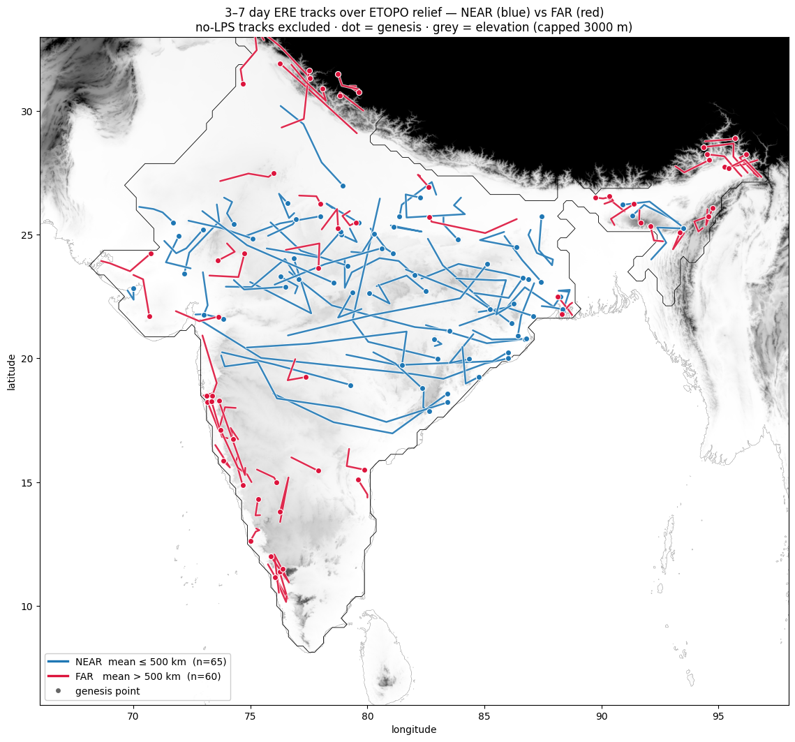

# Lagrangian Tracking of Indian Monsoon Extreme Rainfall Events

A Python pipeline that detects **extreme rainfall events (EREs)** over India during the summer monsoon (June–September), follows them from day to day as moving objects, including **merges and splits**, and then asks what physically produces the multi-day tracks.

*Summer research project, IIT Bombay, with Prof. Akshaya Nikumbh (May–Aug 2026).*

---

## Highlights

- **Tracker.** Per-cell 99th-percentile thresholds (floored at 50 mm/day) define the extremes. Connected objects are linked across days by a symmetric *mean-overlap* score, and merges, splits, continuations, births and deaths are recorded explicitly, with no distance-based "teleport" links.
- **ERA5, 1979–2024 (CP3–CP5).** At 0.25° resolution, the continuation rate rises from 9.9% (at 1°) to 44.6%. The final mean-overlap tracker finds 10,965 tracks with 173 merges and 124 splits.
- **IMERG, 2000–2024 (CP6).** 10,006 tracks, 71 merges and 51 splits.
- **Are multi-day tracks real weather systems?** They sit much closer to monsoon **low-pressure system (LPS)** centres than rain objects overall: median distance 427 km vs 737 km. The rain is displaced about 200 km south-west of the depression centre, as reported in the literature.
- **What drives the tracks far from any LPS?** Orography. Far tracks sit on markedly steeper, rougher terrain than LPS-linked tracks (all six terrain and wind metrics, p ≤ 1×10⁻³). Their terrain metrics are 12–19 standard deviations above a spatial relocation null. They also move more slowly (75 vs 124 km/day), as expected for rain anchored to hills.

<p align="center">
  
</p>

---

## Repository structure

```
ERE_Tracking/
├── README.md                     ← this file
├── requirements.txt
├── data/README.md                ← datasets and where to get them
├── figures/                      ← key plots exported from the notebooks
└── checkpoints/                  ← one folder per research checkpoint, in order
    ├── CP1_datasets_and_thresholds/
    ├── CP2_tracking_era5_1deg/
    ├── CP3_tracking_era5_0p25deg/
    ├── CP4_connectivity_and_size_filter/
    ├── CP5_merge_split_tracking/
    └── CP6_imerg_lps_orography/
```

Every checkpoint folder has its own `README.md`. Each notebook (`.ipynb`, with all outputs and figures) sits next to a `.py` script converted from it. The script keeps the cells in the same order (`# %%` markers) and opens as a notebook in VS Code or Jupytext.

---

## Checkpoints

| # | Folder | What it does | Key outcome |
|---|---|---|---|
| CP1 | [`CP1_datasets_and_thresholds`](checkpoints/CP1_datasets_and_thresholds) | ERA5 download (CDS API), daily JJAS precipitation, per-cell extreme thresholds | Daily 1° dataset 1998–2020 |
| CP2 | [`CP2_tracking_era5_1deg`](checkpoints/CP2_tracking_era5_1deg) | First detection and tracking at 1°; NT / NE / S-bar trends | 97.7% of day-to-day pairs share no cells at 1°, so resolution is the bottleneck |
| CP3 | [`CP3_tracking_era5_0p25deg`](checkpoints/CP3_tracking_era5_0p25deg) | 0.25°, 1979–2024, India-only mask, search-box fallback, gap tolerance | Continuation rate 44.6%; June anomaly resolved; known events detected |
| CP4 | [`CP4_connectivity_and_size_filter`](checkpoints/CP4_connectivity_and_size_filter) | 4- vs 8-connectivity, ≥16-cell filter, Mann-Kendall trends | With the size filter, trends match Nikumbh et al. (2019) in direction |
| CP5 | [`CP5_merge_split_tracking`](checkpoints/CP5_merge_split_tracking) | Unified tracker with explicit merges and splits; MAX vs MIN vs MEAN overlap; fallback removed | Final MEAN tracker: 10,965 tracks, 173 merges, 124 splits |
| CP6 | [`CP6_imerg_lps_orography`](checkpoints/CP6_imerg_lps_orography) | Wind-steering test, IMERG tracking, LPS co-location, orographic attribution | Multi-day tracks follow LPS; tracks far from LPS are terrain-anchored |

---

## Method in brief

1. **Threshold.** For each 0.25° land cell, the 99th percentile of wet-day (>1 mm) rainfall, with a 50 mm/day floor. Cells outside India never exceed.
2. **Detect.** Daily exceedance cells grouped into connected objects (4-connectivity in CP3–CP4, 8-connectivity from CP5).
3. **Link.** Objects on consecutive days are linked by the mean of forward and backward overlap fractions (gate 0.10). The order is merges → splits → continuations → deaths → births. A track ends when most of it leaves India, and seasons reset on 30 September.
4. **Validate.**
   - Same-date nearest-LPS distance, using the Vishnu et al. LPS catalogue.
   - A track-level re-dating null.
   - NEAR / FAR / NO-LPS classification.
5. **Attribute.**
   - ETOPO 2022 slope, roughness and steep fraction under each track footprint.
   - An above-ground per-cell wind (850/800/750/700 hPa) for uphill-flow metrics.
   - Mann-Whitney / Cliff's δ tests, plus a spatial relocation null.

---

## Getting started

The notebooks were developed and run on **Kaggle** (inputs under `/kaggle/input/...`). To run them elsewhere:

```bash
git clone https://github.com/Divyansh-yecho/ERE_Tracking.git
cd ERE_Tracking
pip install -r requirements.txt
```

Then download the inputs listed in [`data/README.md`](data/README.md) and change the input paths at the top of each notebook or script. CP1 needs your own Copernicus CDS API key in `~/.cdsapirc`.

---

## Data

| Dataset | Used in | Purpose |
|---|---|---|
| ERA5 total precipitation (1°, 1998–2020) | CP1–CP2 | First detection and tracking |
| ERA5 total precipitation (0.25°, 1979–2024) | CP3–CP5, CP6a | Main ERA5 tracking |
| NASA IMERG daily precipitation (0.25°, 2000–2024) | CP6b–c | Satellite-based tracking |
| ERA5 winds at 850 / 800 / 750 / 700 hPa | CP6 | Steering test and uphill-flow metrics |
| Vishnu et al. monsoon LPS track catalogue | CP6b–c | Independent depression centres |
| ETOPO 2022 relief | CP6c | Terrain metrics |

Full details are in [`data/README.md`](data/README.md).

---

## References

- Nikumbh, A. C., Chakraborty, A. & Bhat, G. S. (2019). Recent spatial aggregation tendency of rainfall extremes over India. *Scientific Reports*, 9, 10321.
- Sullivan et al. (2019): the 15% overlap-tracking criterion adopted in CP2–CP3.
- Vishnu, S., Boos, W. R., Ullrich, P. A. & O'Brien, T. A. (2020). Global track catalogue of monsoon low-pressure systems. Zenodo, doi:10.5281/zenodo.3890646.
- Hersbach, H. et al. (2020). The ERA5 global reanalysis. *QJRMS*, 146, 1999–2049.
- Huffman, G. J. et al. NASA GPM Integrated Multi-satellite Retrievals for GPM (IMERG).
- NOAA NCEI (2022). ETOPO 2022 15 Arc-Second Global Relief Model.

---

**Author:** Divyansh Yecho, BS-MS (Physics major, Data Science minor), IISER Pune · [GitHub](https://github.com/Divyansh-yecho)
