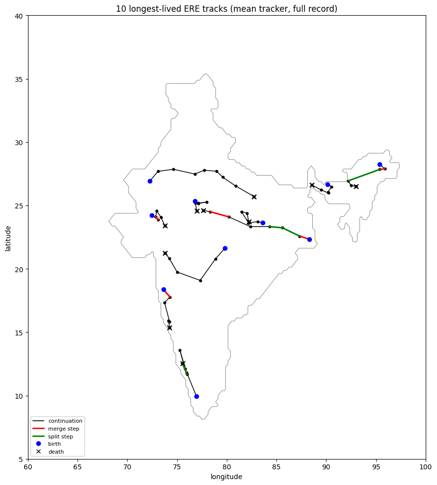

# Checkpoint 5 — Unified Tracker with Explicit Merges and Splits

**ERA5 0.25° | India-only | JJAS 1979–2024 | 8-connectivity objects**

| Notebook | Script | Purpose |
|---|---|---|
| [`cp5a_overlap_rule_comparison.ipynb`](cp5a_overlap_rule_comparison.ipynb) | [`cp5a_overlap_rule_comparison.py`](cp5a_overlap_rule_comparison.py) | Compare overlap rules (MAX vs MIN), with and without the centroid fallback |
| [`cp5b_mean_tracker_no_fallback.ipynb`](cp5b_mean_tracker_no_fallback.ipynb) | [`cp5b_mean_tracker_no_fallback.py`](cp5b_mean_tracker_no_fallback.py) | Final MEAN-overlap tracker without fallback: statistics and maps |

---

## Why this checkpoint

CP3 and CP4 forced every link to be one-to-one, so a **merge** (two systems joining) or a **split** (one system breaking up) showed up as a false death or a false birth. CP5 rebuilds the tracker so that merges, splits and continuations are recorded explicitly. The link order each day is merges → splits → continuations → deaths → births.

Every link is scored by how much two objects overlap from both sides:
- **forward overlap**: shared cells as a fraction of today's object;
- **backward overlap**: shared cells as a fraction of tomorrow's object.

## CP5a: which overlap rule?

| Rule (gate 0.10) | Tracks | Merges | Splits |
|---|---|---|---|
| MAX = max(fwd, bwd) | 8,856 | 179 | 132 |
| MIN = min(fwd, bwd) | 8,841 | 39 | 29 |

- **MIN is too strict.** Of 204 merge candidates, MAX keeps 88% and MIN only 19%. In 95% of the cases MIN misses, the backward overlap is the limiting term, because a merged object is about 2.5× larger than its parents.
- **The centroid fallback is mostly "teleporting".** With the 2° fallback, 45.5% of MAX continuations come from the fallback, and **97.9% of those share zero cells**. Fallback steps are about twice as long as true overlap steps (median 130 km vs 58 km).
- **Without the fallback,** the real overlap-based continuation rate is 19.2% (MAX) or 14.8% (MIN).
- **Threshold floor check.** The 50 mm/day floor binds in 26.2% of India cells and removes 11.1% of the native 99th-percentile exceedances, mostly low-intensity "extremes" in arid or rain-shadow cells.

## CP5b: final MEAN tracker (no fallback)

The MEAN score, (fwd + bwd) / 2, is the symmetric compromise between MAX (which over-links incidental containment) and MIN (which drops most real merges and splits).

| Metric | Value |
|---|---|
| Total tracks | **10,965** |
| Merges / splits | **173 / 124** |
| Object-days | 13,659 |
| Tracks per season | 238.4 |
| Single-day tracks | 82.2% |
| Longest track | 9 days (20–28 June 1996) |

- **Removing the fallback** turns about 2,100 teleport links into separate deaths and births, raising the track count from 8,856 to 10,965.
- **A controlled re-run with the 2° fallback** shows it would account for 47% of all continuations, every one sharing zero cells, and that fallback steps are 1.6× longer on average.

**Later revision.** The MEAN score can still pass one-sided edge contacts (a small sliver brushing a large object). From [CP7](../CP7_regional_trend_analysis) on, a merge or split also needs `min(fwd, bwd) ≥ 0.05`; continuations are unchanged.

## Next

[CP6](../CP6_imerg_lps_orography) moves the MEAN tracker to IMERG satellite rainfall and asks what physically produces the multi-day tracks.
