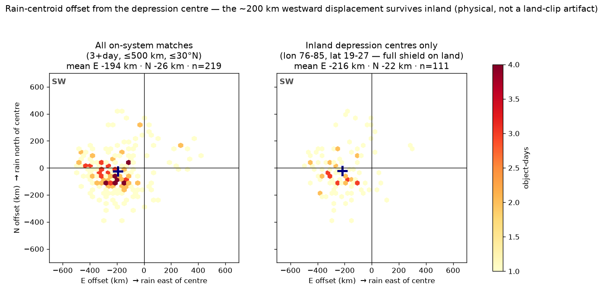
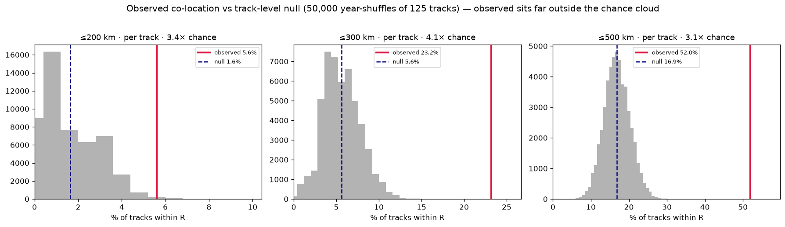
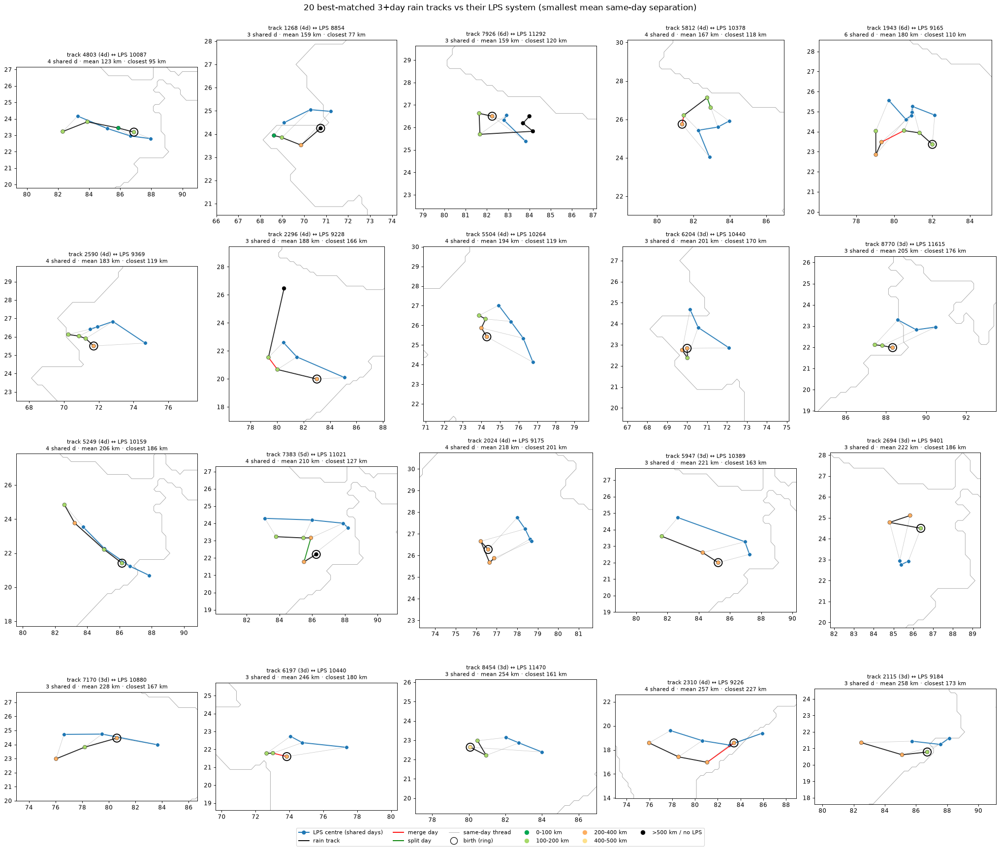
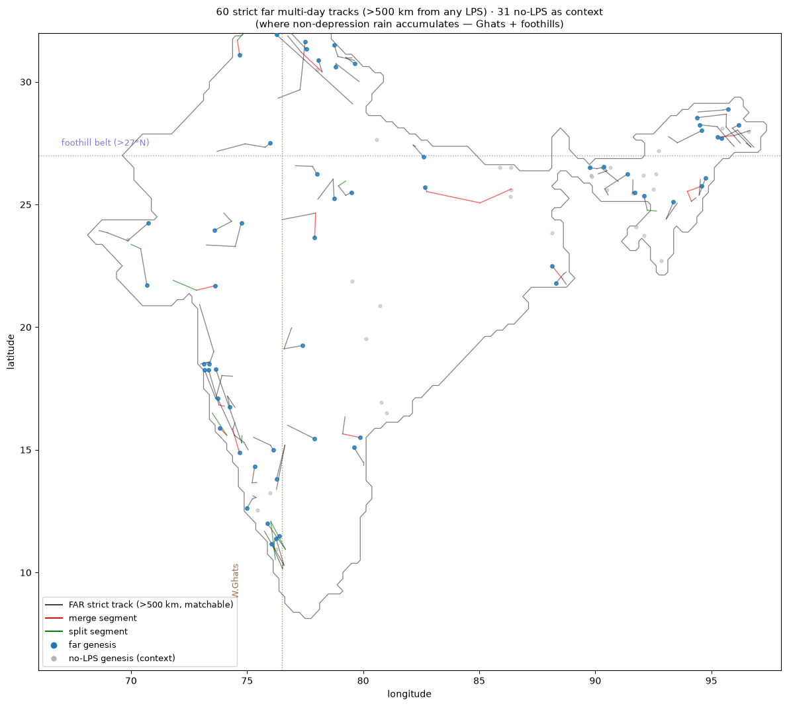
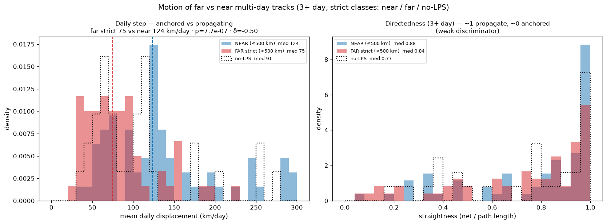
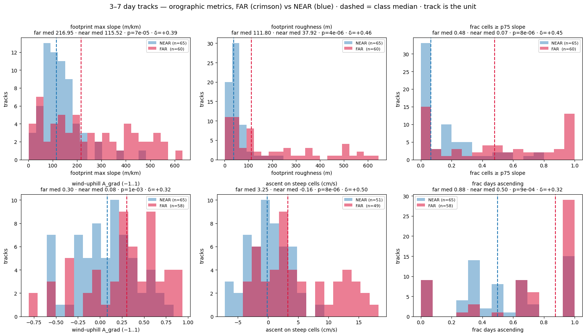

# Checkpoint 6 — What Drives Multi-Day ERE Tracks? Wind, LPS and Orography

| Notebook (Kaggle) | Script | Question |
|---|---|---|
| [`cp6a_wind_steering_test.ipynb`](cp6a_wind_steering_test.ipynb) | [`cp6a_wind_steering_test.py`](cp6a_wind_steering_test.py) | Does the 850 hPa wind steer the tracks? |
| [`cp6b_imerg_tracking_lps_colocation.ipynb`](cp6b_imerg_tracking_lps_colocation.ipynb) | [`cp6b_imerg_tracking_lps_colocation.py`](cp6b_imerg_tracking_lps_colocation.py) | Do multi-day tracks follow monsoon low-pressure systems (LPS)? |
| [`cp6c_orographic_attribution.ipynb`](cp6c_orographic_attribution.ipynb) | [`cp6c_orographic_attribution.py`](cp6c_orographic_attribution.py) | What drives the tracks that are far from any LPS? |

The CP6b notebook holds the corrected code (strict FAR class, symmetric null pool, inland offset test); those cells were not re-run on Kaggle, so they have no stored output. The local scripts below reproduce every CP6b result and figure from the IMERG file and the LPS table alone (see [`data/README.md`](../../data/README.md)):

| Local script | Output |
|---|---|
| [`cp6_build_imerg_catalogue.py`](cp6_build_imerg_catalogue.py) | The IMERG track catalogue under both merge/split gates, with rainfall statistics and nearest-LPS distance for every object-day. Used by CP6, CP7 and CP8. |
| [`cp6_lps_figures.py`](cp6_lps_figures.py) | Co-location statistics; rain offset, best-matched, longest-track, FAR-map and motion figures |
| [`cp6_lps_null.py`](cp6_lps_null.py) | Track-level re-dating null (50,000 shuffles) and its figure |

```bash
python checkpoints/CP6_imerg_lps_orography/cp6_build_imerg_catalogue.py   # ~1 min
python checkpoints/CP6_imerg_lps_orography/cp6_lps_figures.py
python checkpoints/CP6_imerg_lps_orography/cp6_lps_null.py
```

The tracker only links rain objects by overlap. It has no wind and no dynamics. That raises an obvious objection: are the multi-day tracks real weather systems, or chance chains of unrelated rain blobs? This checkpoint tests it.

---

## CP6a — Wind as a steering vector: rejected

The ERA5 850 hPa wind was first validated: it has no missing values, its grid matches the rainfall grid, and it shows the south-westerly monsoon flow over the Arabian Sea and Bay of Bengal. Its footprint-mean direction was then compared with each track step.

- **ERA5 multi-day tracks, 313 clean steps:** mean cos(Δ) = −0.04, only 48% of steps within 90° of the wind, Rayleigh test cannot reject uniform (p = 0.26), tracks move at 0.16× the wind speed.
- **IMERG (CP6b):** 69% of clean steps point *against* the footprint wind. The wind direction is quasi-fixed from year to year (circular s.d. 8°), i.e. a background flow.

So the low-level wind does not steer the tracks. Wind failing to *steer* a track does not rule out wind being *lifted by terrain* under it (tested in CP6c).

## CP6b — IMERG tracking and LPS co-location

The CP5 MEAN tracker re-run on **NASA IMERG** (0.25°, JJAS 2000–2024): **10,006 tracks, 10,877 object-days, 71 merges, 51 splits**. 93.5% of tracks last one day; 156 last 3 or more days (longest 7 days). Under the stricter MIN-0.05 merge/split gate used from CP7 on, the catalogue is identical except for 28 merges and 17 splits.

LPS centres come from the Vishnu et al. (2020) catalogue, which is derived from ERA5 circulation only: 2,232 system-days, 345 systems (~15 per season), 2000–2022. Every rain object-day is joined to the nearest LPS centre on the **same calendar date** (haversine distance). 7,080 object-days have an LPS somewhere that day; 3,797 do not (841 of them in 2023–24, after the catalogue ends).

| Population | Median distance to nearest LPS | Within 500 km |
|---|---|---|
| All matchable object-days | 737 km | 35.1% |
| Object-days of multi-day tracks (> 2 days, n = 395) | **427 km** | **56.2%** |

- **Longer tracks sit closer to depressions:** per-track median 763 km for 1–2-day tracks vs 370 km for 5+ day tracks (Mann-Whitney p = 8×10⁻³).
- **Rain is offset west-south-west of the centre.** On 219 close on-system pairs the rain centroid sits on average 194 km west and 26 km south (58% in the SW quadrant). Restricted to inland centres (76–85°E, 19–27°N, n = 111) the offset is 216 km west, so it is not a land-mask artifact. This matches the ~200 km displacement of Boos et al. (2023).

<p align="center"></p>

**Track-level null.** Each 3+ day track is kept rigid and re-dated to a random other catalogue year, which keeps the seasonal cycle but breaks the real-year alignment. The pool is the 125 tracks with at least one LPS day; the track is the unit; 50,000 shuffles:

| Radius | Observed | Chance | Enrichment | p |
|---|---|---|---|---|
| 200 km | 5.6% | 1.6% ± 1.2% | 3.4× | 4×10⁻³ |
| 300 km | 23.2% | 5.6% ± 2.2% | 4.1× | < 2×10⁻⁵ |
| 500 km | 52.0% | 16.9% ± 3.4% | 3.1× | < 2×10⁻⁵ |

The first version of this null also re-dated the 31 never-matched tracks, which cannot enter the observed fraction; that asymmetric pool gave 3.8× / 4.6× / 3.3×. The corrected values above are lower but the conclusion stands: multi-day tracks co-locate with independent depression centres at 3–4× chance.

<p align="center"></p>

<p align="center"></p>

**Classification of the 156 tracks lasting 3+ days** by mean nearest-LPS distance over their LPS days: **NEAR** (≤ 500 km) 65, **FAR** (> 500 km) 60, **NO-LPS** (no LPS on any day, including every 2023–24 track) 31. NO-LPS is kept separate and is not pooled into FAR.

- **Where they are born:** NEAR tracks 77% in central India; FAR tracks only 12% in central India but 28% on the Western Ghats and 30% in the northern foothills.
- **How they move:** FAR tracks move at 75 km/day vs 124 km/day for NEAR (Mann-Whitney p = 7.7×10⁻⁷, Cliff's δ = −0.50); NO-LPS tracks are in between (91 km/day). Straightness hardly differs (0.84 vs 0.88). NEAR tracks are embedded in moving depressions, so "near moves more" is partly by definition.

<p align="center">
</p>

## CP6c — Orographic attribution of FAR tracks

- **Terrain.** ETOPO 2022 (~1 km) slope, roughness and fraction of steep cells, computed at native resolution and then aggregated to 0.25° over land only (regridding elevation first would flatten the Ghats escarpment).
- **Above-ground wind.** Over high terrain the 850 hPa level is below ground (19% of FAR object-days sit above 1400 m), so each cell uses the nearest above-ground level:

  | Cell elevation | Wind level used |
  |---|---|
  | below 1400 m | 850 hPa |
  | up to 1950 m | 800 hPa |
  | up to 2470 m | 750 hPa |
  | up to 3010 m | 700 hPa (none above) |

**Uprising test, 3–7-day tracks (FAR 60 vs NEAR 65)**, metrics sampled under the full footprint, track as the unit:

| Metric (footprint median) | FAR | NEAR | p (FAR > NEAR) | Cliff's δ |
|---|---|---|---|---|
| Max slope (m/km) | 217 | 116 | 7×10⁻⁵ | +0.39 |
| Roughness (m) | 112 | 38 | 4×10⁻⁶ | +0.46 |
| Fraction of steep cells | 0.48 | 0.07 | 8×10⁻⁶ | +0.45 |
| Wind-uphill alignment A_grad (−1..1) | 0.30 | 0.08 | 1×10⁻³ | +0.32 |
| Ascent on steep cells (cm/s) | 3.25 | −0.16 | 8×10⁻⁶ | +0.50 |
| Fraction of days ascending | 0.88 | 0.50 | 9×10⁻⁴ | +0.32 |

**Spatial relocation null** (FAR tracks slid to random positions over India, 5,000 shuffles): slope 12.4σ, roughness 15.7σ, fraction steep 18.7σ, A_grad 4.3σ and fraction ascending 1.9σ above the null.

**What these tests cannot separate.** FAR is defined by distance from depressions, which live in central India, so FAR largely means "near the mountainous margins":

- The terrain contrast persists for 2-day tracks (δ ≈ +0.38) and even for one-day objects (δ ≈ +0.21, p ≈ 10⁻³⁸), which have no multi-day coherence at all. It is a property of *where* a rain object sits.
- A **day-shuffle null** keeps each FAR track on its own cells and draws the wind from random monsoon days: observed A_grad +0.270 vs +0.240 ± 0.043 (0.7σ, p = 0.25). The upslope flow is the climatological monsoon state, not something specific to the rain days.

<p align="center"></p>
<p align="center"></p>

## Conclusions

1. **Multi-day ERE tracks are real weather systems.** They co-locate with independent depression centres at 3–4× chance, with the expected west-south-west rain offset.
2. **Tracks far from any LPS sit in orographic settings and move slowly** (Western Ghats, Himalayan foothills, north-east hills). They are *consistent with* terrain-anchored rain, but the terrain contrast is largely set by where FAR tracks are by definition, and the uphill wind is climatological. Their slowness is the strongest evidence that they are coherent systems.

## Open items

- Test FAR tracks against the systems the LPS catalogue omits (offshore vortices, mid-tropospheric cyclones) with the same day-specific null.
- A relocation null restricted to boundary/mountain locations; a per-region breakdown (the 60 FAR tracks cluster in about three regions).
- Moisture-flux version of the uphill metric (q·V·∇h instead of the dry V·∇h).

## Next

[CP7](../CP7_regional_trend_analysis) uses this catalogue for the regional and life-cycle analysis.
