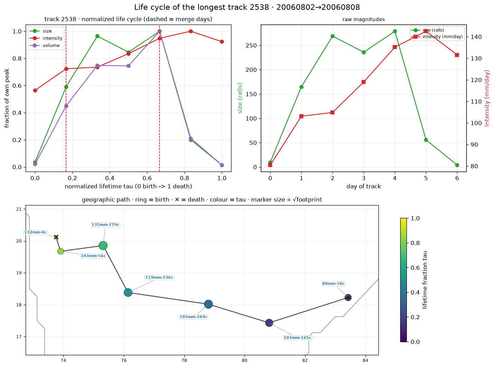
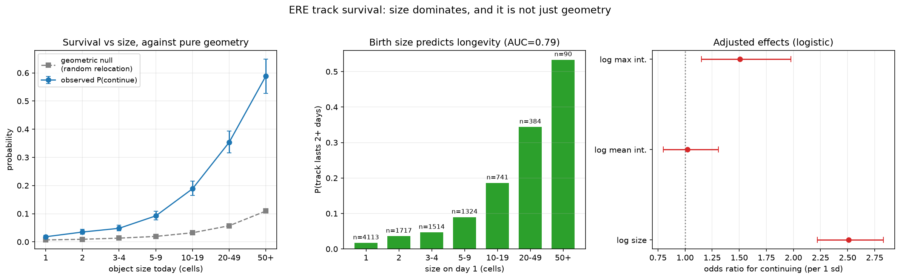
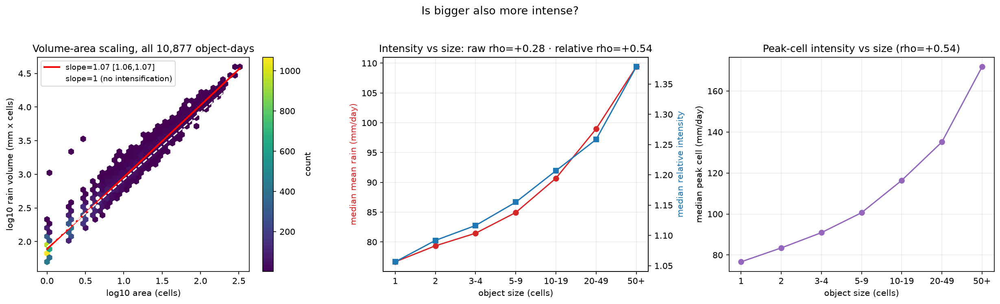
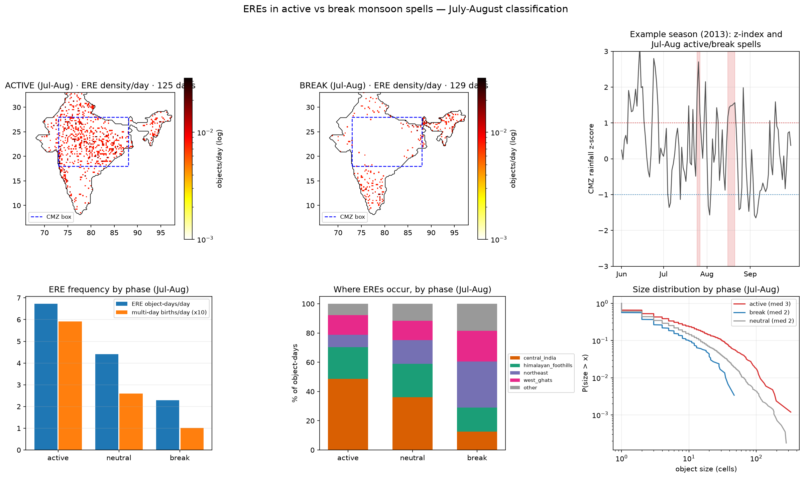
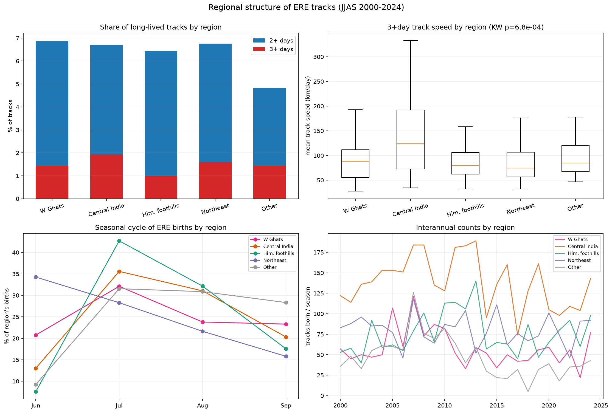
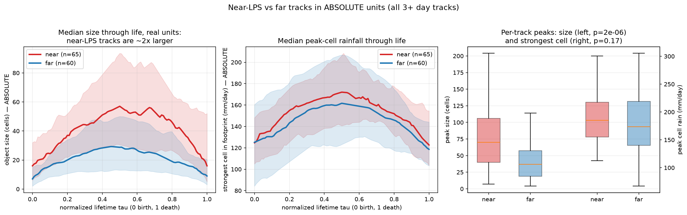
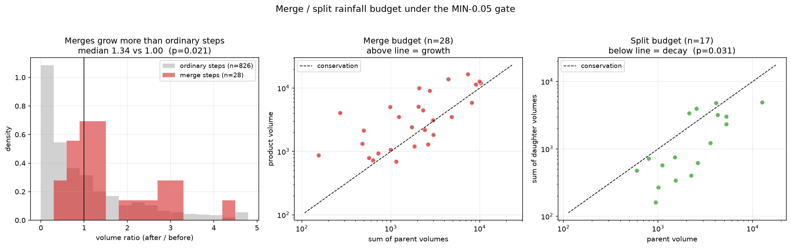
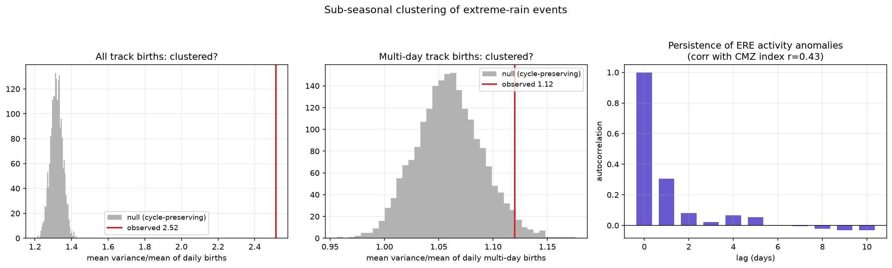

# Checkpoint 7 — Regional Patterns, Life Cycles and Active/Break Spells of IMERG ERE Tracks

**IMERG 0.25° | India | JJAS 2000–2024 | 10,006 tracks · 10,877 object-days · 28 merges · 17 splits**

All results come from the CP6 IMERG catalogue and run locally in a few minutes. Run the CP6 catalogue builder first, then the scripts in order:

```bash
python checkpoints/CP6_imerg_lps_orography/cp6_build_imerg_catalogue.py
python checkpoints/CP7_regional_trend_analysis/cp7_00_prepare_tables.py
python checkpoints/CP7_regional_trend_analysis/cp7_01_survival.py      # ... up to cp7_09
```

| Script | Result | Figure |
|---|---|---|
| [`cp7_00_prepare_tables.py`](cp7_00_prepare_tables.py) | Regions, LPS class, core-monsoon-zone spell index, per-track tables | — |
| [`cp7_01_survival.py`](cp7_01_survival.py) | Size predicts survival, beyond geometry | `cp7_01_survival.png` |
| [`cp7_02_scaling.py`](cp7_02_scaling.py) | Bigger objects are rainier per cell | `cp7_02_scaling.png` |
| [`cp7_03_active_break.py`](cp7_03_active_break.py) | Active/break spells reorganise ERE activity (+ definition audit and sensitivity) | `cp7_03_active_break.png` |
| [`cp7_04_regions.py`](cp7_04_regions.py) | Regional structure, interannual co-variation and trends | `cp7_04_regions.png` |
| [`cp7_05_lifecycle.py`](cp7_05_lifecycle.py) | Near-LPS vs far life cycles: size, intensity, timing | `cp7_05_lifecycle.png` |
| [`cp7_06_merge_split.py`](cp7_06_merge_split.py) | Rainfall budget of merges and splits (MIN-0.05 gate) | `cp7_06_merge_split.png` |
| [`cp7_07_clustering.py`](cp7_07_clustering.py) | EREs arrive in multi-day episodes | `cp7_07_clustering.png` |
| [`cp7_08_catalogue_gallery.py`](cp7_08_catalogue_gallery.py) | Longest tracks, duration vs size, density maps, life cycles | `cp7_08_*.png` |
| [`cp7_09_merge_split_events.py`](cp7_09_merge_split_events.py) | Maps of individual merge and split events | `cp7_09_*.png` |

Every script prints the numbers quoted below. Figures are written to [`figures/`](../../figures).

## Definitions

- **Size**: grid cells in the object on a given day (1 cell ≈ 713 km²). **Intensity**: mean rain over the object (mm/day); **peak cell**: its wettest cell.
- **Relative intensity**: mean rain divided by the mean detection threshold under the footprint (1.0 = rain right at the local extreme level). This removes the effect of the threshold varying from place to place.
- **LPS class** (from CP6): near (mean nearest-LPS distance ≤ 500 km), far (> 500 km), no-LPS (no LPS on any of the track's days).
- **Region** (by birth centroid): Western Ghats, Central India, Himalayan foothills, Northeast, Other.
- **Active / break spells**: daily mean IMERG rain over the land cells of the core monsoon zone (18–28°N, 73–88°E), standardised per calendar day against a 15-day-smoothed 25-season climatology. Active = z ≥ +1 for ≥ 3 days, break = z ≤ −1 for ≥ 3 days, **classified on July–August only** (125 active and 129 break days). In June the monsoon is still arriving and in September it is withdrawing; a JJAS-wide rule puts 175 of its 304 "break" days in June or September.
- **Merges and splits** use `min(fwd, bwd) ≥ 0.05` (forward/backward overlap fractions). The CP5/CP6 rule `(fwd + bwd)/2 ≥ 0.10` also accepted one-sided edge contacts (a sliver brushing a large object); the stricter gate keeps 28 of 71 merges and 17 of 51 splits. Tracks, object-days, durations and LPS classes are identical under both gates.

## The catalogue

The ten longest tracks last 5–7 days, are large (tens to hundreds of cells) and mostly travel west to north-west across central and northern India. Median peak size rises from 2 cells for 1-day tracks to 169 cells for 7-day tracks (Spearman ρ = 0.38). Objects live and are born in the same four bands: the Western Ghats coast, the central-Indian monsoon belt, the Himalayan foothills and the Northeast.

<p align="center"></p>

Further catalogue figures: [`cp7_08_longest_tracks.png`](../../figures/cp7_08_longest_tracks.png), [`cp7_08_size_vs_duration.png`](../../figures/cp7_08_size_vs_duration.png), [`cp7_08_density.png`](../../figures/cp7_08_density.png), [`cp7_08_lifecycles_top10.png`](../../figures/cp7_08_lifecycles_top10.png), [`cp7_09_merges_two_parent.png`](../../figures/cp7_09_merges_two_parent.png), [`cp7_09_splits_two_daughter.png`](../../figures/cp7_09_splits_two_daughter.png), [`cp7_09_merges_multi_parent.png`](../../figures/cp7_09_merges_multi_parent.png), [`cp7_09_splits_multi_daughter.png`](../../figures/cp7_09_splits_multi_daughter.png).

## 1. Larger objects survive longer, and not because of overlap geometry

| Size today (cells) | 1 | 2 | 3–4 | 5–9 | 10–19 | 20–49 | 50+ |
|---|---|---|---|---|---|---|---|
| P(survives to tomorrow) | 1.8% | 3.5% | 4.8% | 9.2% | 18.8% | 35.3% | 58.9% |
| Random-placement expectation | 0.7% | 0.9% | 1.3% | 1.9% | 3.2% | 5.7% | 10.9% |

Days ending by season end, domain exit or merge are excluded. The null slides each footprint (same shape) to random positions over India and asks how often it would touch any real next-day object; observed survival is 3–6× that rate. Day-1 size separates tracks lasting 2+ days with AUC = 0.79 (per season 0.68–0.89). In a logistic model, size dominates (odds ratio 2.5 per s.d.), mean intensity adds nothing (1.0) and peak-cell intensity a little (1.5).

<p align="center"></p>

## 2. Larger objects are also rainier per cell

Raw intensity hardly depends on size (ρ = +0.28) because the threshold varies across India. Relative intensity does: ρ = +0.54 overall, +0.50 to +0.61 in every region, positive in all 25 seasons (+0.44 to +0.66). Rain volume grows faster than area (log-log slope 1.069 [1.065, 1.073]; 1.075 without 1-cell objects). Median relative intensity rises from 1.06 (1 cell) to 1.38 (50+ cells), and the median wettest cell from 77 to 172 mm/day.

<p align="center"></p>

## 3. Active and break spells reorganise ERE activity

| July–August | Active | Neutral | Break |
|---|---|---|---|
| Days | 125 | 1,296 | 129 |
| ERE object-days per day | 6.7 | 4.4 | 2.3 |
| Multi-day track births per day | 0.59 | 0.26 | 0.10 |
| Extreme rain volume per day (mm × cells) | 7,930 | 2,802 | 811 |
| Share in Central India | 49% | 36% | 13% |
| Share in the Northeast | 8% | 16% | 31% |

Active spells hold ~3× the ERE activity of breaks and ~6× the multi-day births, with larger objects (median 3 vs 2 cells, p = 1×10⁻⁷). Shares must sum to 100%, so the absolute rate is the better test: only the **Northeast gains** in breaks (0.56 → 0.72 object-days/day), while Central India collapses (3.28 → 0.29) and the Western Ghats declines (0.90 → 0.48) even though its share rises. The index is built from core-zone rain, so the central-India numbers are partly circular; the absolute Northeast increase, the multi-day birth rates and the size difference are not. CP8 confirms the spells in independent OLR and ties them to the BSISO.

| Definition variant | Activity ratio (active/break) | NE share, active → break |
|---|---|---|
| Jul–Aug, 18–28°N 73–88°E, z ±1.0 (used) | 2.9 | 8% → 31% |
| z ±0.75 | 2.8 | 10% → 29% |
| z ±1.25 | 3.1 | 9% → 35% |
| Box 16–26°N, 74–86°E | 2.7 | 8% → 33% |
| Box 18–28°N, 65–88°E | 3.0 | 10% → 32% |
| Full JJAS classification | 3.1 | 11% → 42% |

<p align="center"></p>

## 4. Regional structure

- The size–longevity link holds in every region (Spearman ρ of duration with peak size +0.33 to +0.40).
- 3+ day track speed differs by region (Kruskal-Wallis p = 7×10⁻⁴): Central India 124 km/day, Ghats 88, foothills 80, Northeast 75. Central India also has the most tracks near an LPS (41% vs 4–13% in the Ghats, foothills and Northeast).
- Central India is the most active region: 3,465 of 10,006 tracks (232 lasting 2+ days, 67 lasting 3+), and the largest multi-day objects (median peak 33 cells vs 15–17 elsewhere). The fraction of tracks surviving past day 1 is almost the same everywhere (6.4–6.9%; 4.8% in "Other"): regions differ in how many systems they spawn, not in how likely they are to persist.
- Northeast births peak in June, the other regions in July.
- Interannual: Northeast counts are uncorrelated with every other region (|ρ| ≤ 0.18, p ≥ 0.4); the other regions co-vary weakly (mean pairwise ρ = +0.41). No significant trend in any named region or all-India (Mann-Kendall p = 0.22–0.53; Theil-Sen within ±1 track/season per region); the residual "Other" box is marginal (p = 0.05). 25 seasons give little power.

<p align="center"></p>

## 5. Life cycles of near-LPS and far tracks (3+ days)

| Median over tracks | Near-LPS (n = 65) | Far (n = 60) | p (near > far) |
|---|---|---|---|
| Peak size (cells) | 70 | 37 | 2×10⁻⁶ |
| Mean size over life (cells) | 40 | 18 | 1×10⁻⁷ |
| Peak single-cell rain (mm/day) | 185 | 174 | 0.17 |
| Peak footprint-mean rain (mm/day) | 117 | 119 | 0.48 |
| Track speed (km/day) | 124 | 75 | — |

Near tracks are about twice as large but not more intense. They also peak later in life (mean position of the size peak 0.59 vs 0.43 of the lifetime, p = 2×10⁻⁴, bootstrap 95% CI of the difference +0.07 to +0.26) and grow faster (31 vs 18.5 cells/day, p = 0.04). The timing contrast rests mainly on 3-day tracks (0.57 vs 0.40, p = 0.006), whose peak can only fall at 0, 0.5 or 1; for 4-day tracks it runs the same way but is not significant (0.61 vs 0.52, p = 0.2). Only one far track lasts 5+ days, against eight near tracks: durable systems are overwhelmingly LPS-linked.

<p align="center"></p>

## 6. Merges grow and concentrate rainfall; splits decay

Against 826 ordinary continuation steps (median volume ratio 1.00):

- **Merges (28):** the product carries a median **1.34×** the parents' combined rain (p = 0.02); in 79% it is also more intense per cell than the parents.
- **Splits (17):** the daughters carry a median **0.50×** the parent's rain (p = 0.03); volume falls in 82%.

The effects are moderate (the looser MEAN gate suggested a much larger jump, inflated by one-sided contacts), the samples are small, and this is co-occurrence in time, not proven cause.

<p align="center"></p>

## 7. EREs arrive in multi-day episodes

Against 2,000 null seasons that keep each season's total and the mean seasonal cycle, daily birth counts are strongly over-dispersed (variance/mean 2.52 vs 1.32 ± 0.03, p = 5×10⁻⁴; same with a second seed). Multi-day births are weakly clustered (1.12 vs 1.06, p = 0.03); large (20+ cell) births cannot be distinguished from random (p = 0.12). The lag-1 autocorrelation of daily anomalies is 0.24 for births (0.30 for object-days, partly mechanical), and ERE activity correlates with the core-zone index (r = 0.43).

<p align="center"></p>

## No signal

- Pooled growth vs decay rate (p = 0.76); the timing difference appears only between LPS classes.
- Intensity peaking before size: peaks fall on the same day in 69% of tracks (intensity first 16%, size first 15%, p = 0.27).
- Rain intensity of near vs far tracks; regional differences in day-1 survival; clustering of large-object births.

## Limitations

- One dataset (IMERG). IMERG undercounts orographic rain over the Ghats and foothills, exactly where far tracks sit.
- Many tests were run; several p-values of 0.02–0.05 would not survive a multiple-comparison correction. All results are observational.
- Small multi-day samples (156 tracks of 3+ days, 60 far, 28 merges). Regions are lat/lon boxes assigned by birth point.

## Next

[CP8](../CP8_spells_olr_bsiso) checks the active/break spells against independent OLR and the BSISO.
