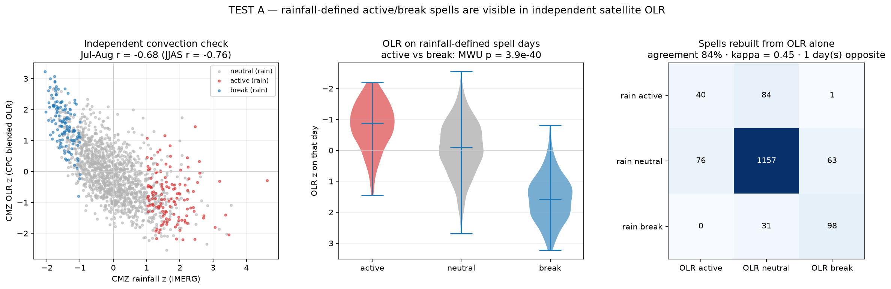
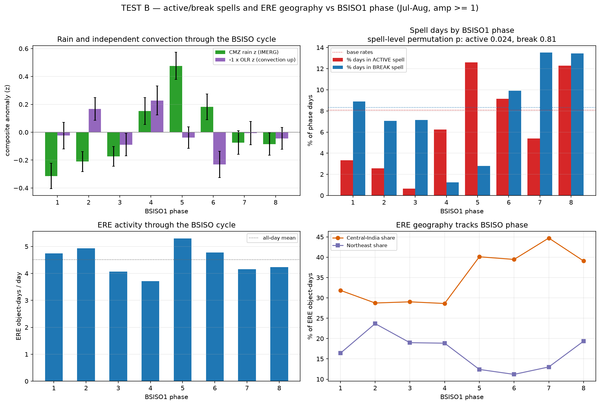
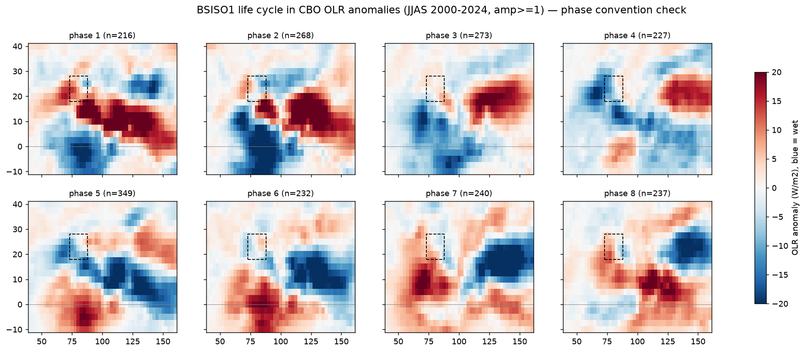
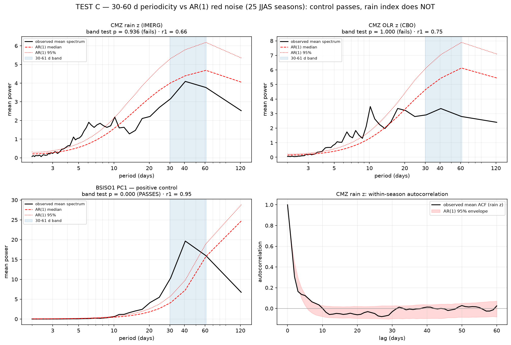
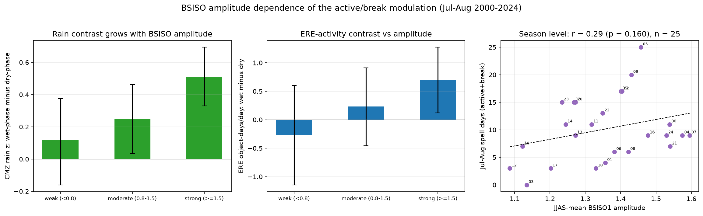

# Checkpoint 8 — Are the Active/Break Spells Real? Validation with OLR and the BSISO

The active/break spells of CP7 are defined from core-monsoon-zone rainfall, so their link to ERE activity is partly circular. This checkpoint tests the spells against two independent datasets: CPC blended **OLR** (satellite convection) and the APCC **BSISO** index of Lee et al. (2013). Inputs are listed in [`data/README.md`](../../data/README.md); CP7's `cp7_00_prepare_tables.py` must have been run first.

| Script | Test | Figure |
|---|---|---|
| [`cp8_00_build_drivers.py`](cp8_00_build_drivers.py) | Daily table: rain z, CMZ OLR z (same standardisation), BSISO PCs, amplitude, phase | — |
| [`cp8_01_olr_independence.py`](cp8_01_olr_independence.py) | Test A: are the spells visible in OLR? | `cp8_01_olr_independence.png` |
| [`cp8_02_bsiso_composites.py`](cp8_02_bsiso_composites.py) | Test B: are spells and ERE geography locked to BSISO phase? | `cp8_02_bsiso_composites.png` |
| [`cp8_03_bsiso_phase_maps.py`](cp8_03_bsiso_phase_maps.py) | Phase-convention check (OLR composites by phase) | `cp8_03_bsiso_phase_maps.png` |
| [`cp8_04_spectrum.py`](cp8_04_spectrum.py) | Test C: is the rain index periodic at 30–60 days? | `cp8_04_spectrum.png` |
| [`cp8_05_amplitude.py`](cp8_05_amplitude.py) | Does the modulation scale with BSISO amplitude? | `cp8_05_amplitude.png` |

**BSISO1 phase** is the octant of atan2(−PC1, PC2), numbered as in Lee et al. (2013). The OLR composites confirm the convention: convection sits over the equatorial Indian Ocean in phases 1–3 and over India in phases 4–6.

## A — The spells are visible in independent OLR

- Daily CMZ rain z and OLR z: r = −0.76 (JJAS; −0.68 in July–August), negative in all 25 seasons.
- On rainfall-defined spell days the OLR z medians are −0.88 (active), −0.11 (neutral) and +1.57 (break); active vs break p = 4×10⁻⁴⁰, Cliff's δ = −0.96.
- Spells rebuilt **from OLR alone** with the mirror rule: 84% agreement, Cohen's κ = 0.45. 76% of rainfall break days are breaks in OLR and none is classified active; only 1 active day of 125 is classified as a break.

## B — Active spells are locked to the BSISO; breaks only weakly

July–August days with BSISO1 amplitude ≥ 1 (1,073 days):

- CMZ rain z peaks in phase 5 (+0.48), with the Central-India share of ERE object-days rising from ~29% (phases 2–4) to 39–45% (phases 5–8) and the Northeast share falling from 24% (phase 2) to 11% (phase 6).
- **Spell level** (each spell takes its modal BSISO1 phase; 10,000 draws from the organised-day pool): active spells cluster around phase 5 (n = 27, p = 0.024); break spells do not (n = 23, p = 0.81). The day-level χ² (p = 5×10⁻⁷) treats consecutive days as independent and is not used.

## C — The daily rain index alone does not show a 30–60 day peak

Mean within-season spectrum against an AR(1) red-noise null (10,000 sets of 25 seasons): CMZ rain z p = 0.94 and OLR z p = 1.0 for the 30–61-day band fraction, while the positive control BSISO1 PC1 passes (p < 10⁻⁴). The test has power; at a single box and 122-day seasons, the rain index is not distinguishable from red noise. The BSISO organisation shows up in the phase composites, not in the spectrum.

## Amplitude dependence

The wet-phase (4–6) minus dry-phase (7, 8, 1) rain contrast grows with BSISO1 amplitude: +0.12 z (weak, CI includes 0), +0.25 (moderate), +0.51 (strong, CI 0.33–0.69). ERE activity follows the same pattern (+0.69 object-days/day when strong). Across seasons, mean amplitude and the number of spell days are only weakly related (r = 0.29, p = 0.16, n = 25).

## Summary

The rainfall-defined spells are real convective episodes (Test A), and active spells and the geography of extreme rain are organised by the BSISO (Test B, amplitude test). Two negatives: break spells are not significantly phase-locked at spell level, and the daily rain index on its own is not spectrally distinct from red noise.
